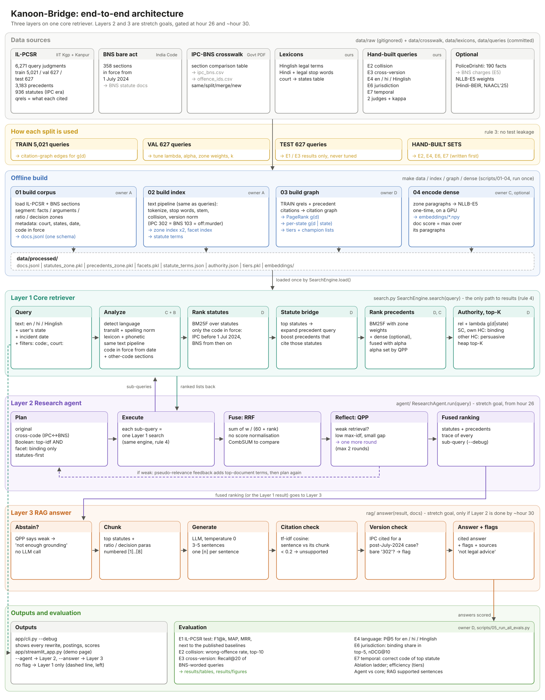

# Kanoon-Bridge

**A multi-layer information retrieval system for India's new criminal codes.**

On 1 July 2024 India replaced the Indian Penal Code (IPC) with the Bharatiya Nyaya Sanhita (BNS),
the Code of Criminal Procedure (CrPC) with the BNSS, and the Evidence Act with the BSA, on a
single day. Almost every section was renumbered: "section 302" is murder in the IPC and a
different offence in the BNS, and which code applies depends on the date of the incident. Courts
will use both codes for years. In a sample of 1,701 High Court criminal judgments, only 8–29% a
month cited the BNS through 2025.

Ordinary legal search and AI assistants therefore often return the wrong law. Kanoon-Bridge is a
three-layer system that fixes this:

1. **Version-aware retrieval** links old and new sections, picks the code in force by the incident
   date, and handles English, Hindi and Hinglish queries.
2. **A research agent** checks the statutes it returns: code family, code in force, heading.
3. **A verified answer layer** computes punishments directly from the statute text and checks
   every claim against its source.

It runs with local LLMs through Ollama, or with no LLM at all. On the IL-PCSR benchmark (EMNLP
2025) and real High Court and bail-order data, it doubles retrieval accuracy on real case facts
(MAP 0.047 → 0.100) and gives the correct punishment 86% of the time, against 6% for a simple
extractive baseline.

> Research prototype, not legal advice.



| Layer | What it does | Code |
| --- | --- | --- |
| **1. Version-aware retrieval** | IPC/BNS (and CrPC/BNSS, IEA/BSA) sections share identifiers; the code in force is chosen by the incident date; colliding numbers are resolved; BM25F over judgment zones, citation authority, a word-trigram channel and learning to rank; transliteration, a Hinglish legal lexicon and spelling correction | `search.py`, `index/`, `rank/`, `query/`, `text/` |
| **Statutory drift** | how far each provision moved from the old code: clause alignment with cross-code renumbering, a parser for punishments in legal English, mental-state and threshold reading → change class and a carry-over score for old precedent | `drift/` |
| **2. Research agent** | routes the question (pasted judgment / section lookup / fact question), picks the code family from what it retrieved, verifies its statutes (family, code in force, heading), checks issue coverage, writes a research memo; optional LLM planner | `agent/` |
| **3. Verified answers** | computes the punishment from the statute text, quotes precedent, checks every sentence (numbers, sections, code in force, negation, quotations), regenerates once and repairs what fails | `rag/` |
| **Judicial treatment** | detects precedents a later judgment overruled, from the judgments' own sentences | `rank/treatment.py` |

Layers 2 and 3 run without any LLM (rule-based agent, computed answers). With an LLM they use a
**local model through Ollama** (no key, nothing leaves the machine), any OpenAI-compatible server
(vLLM, llama.cpp), or the OpenAI / Claude APIs.

## Quick start

```bash
git clone https://github.com/gauravrai1704/Kanoon-bridge && cd Kanoon-bridge
python -m venv .venv && source .venv/bin/activate        # Windows: .venv\Scripts\activate
pip install -e ".[dev]"
make test                                                # 200+ tests, no data needed
```

**Open corpus (no restricted data):** all six codes from India Code plus the BNS, and optionally
real High Court judgments from the eCourts open dataset.

```bash
python scripts/00_fetch_data.py --only bns && python scripts/00_fetch_data.py --only india-code
python scripts/11_hc_judgments.py fetch --years 2024 2025 --per-month 12 && python scripts/11_hc_judgments.py ingest
make open                                                # build the corpus and indexes
python app/cli.py "punishment for murder" --date 2025-01-03 --agent --answer
make web                                                 # http://localhost:8000
```

**Full corpus (IL-PCSR, gated on Hugging Face):** accept its terms, then `make fetch && make build`
(about 6 minutes). Without access, `make sample` runs everything on a tiny synthetic sample.

## Using a local LLM (Ollama)

```bash
ollama pull llama3.2:3b                                   # or llama3.1:8b, mistral, ...
OLLAMA_CONTEXT_LENGTH=8192 ollama serve                  # answer prompts need ~3K tokens; Ollama truncates silently
python app/cli.py "punishment for cheating" --date 2025-01-03 --agent --answer --generator ollama
```

- **Answers (layer 3):** `--generator ollama`, or `rag.generator: ollama` in `configs/default.yaml`.
  The model's answer is verified and corrected like any other.
- **Agent (layer 2):** `agent.planner: hybrid` (rules plus LLM sub-queries) with
  `agent.llm_generator: ollama`.
- **Web app (`make web`):** "Answer by" lists the computed answer and, when they answer, Ollama and
  any API model; "Judgments" restricts results to the new or old codes. Answers show their notes,
  the claims checked and every correction; overruled judgments are badged; with the research agent
  on, its memo is under the answer.
- **Settings:** `OLLAMA_BASE_URL` (default `http://localhost:11434/v1`) and `KB_LLM_MODEL` (default
  `llama3.2:3b`) in `.env`. For vLLM or llama.cpp use `--generator local` with `KB_LLM_BASE_URL`.
- **LLM misgrounding benchmark (E20):** `bash scripts/run_e20_ollama.sh 100 llama3.2:3b llama3.1:8b`
  (checks that Ollama answers first), then `python scripts/25_report_e20.py` prints the tables for
  the README and the paper.
- **Where misgrounding comes from (E25):** `python scripts/27_eval_context_ablation.py --model llama3.2:3b`
  re-asks each E20 RAG answer with the context unchanged and with every old-code passage removed
  (`--diagnose-only` for the no-LLM context diagnosis; `--only-misgrounded` for a quick pass).

## Results

All numbers are produced by the scripts below; paired randomization tests with Holm correction
throughout. Full write-up: [docs/PROJECT.md](docs/PROJECT.md); paper drafts:
[`docs/paper_acm/`](docs/paper_acm) (ACM) and [`docs/paper/`](docs/paper) (ACL).

**Version-aware retrieval against a fair baseline (E23).** Plain BM25 cannot know that BNS 103 is
IPC 302, so we also compare with BM25 given the same crosswalk as query expansion, with and without
the date rule (`eval/baselines.py`). MAP, IL-PCSR corpus:

| Set | BM25 | BM25 + crosswalk | + date filter | **Kanoon-Bridge** |
| --- | --- | --- | --- | --- |
| E3 precedents, asked in BNS numbers | 0.006 | 0.307 | 0.307 | **0.655** † |
| E3 control, asked in IPC numbers | 0.503 | 0.411 | 0.411 | **0.769** † |
| E8 precedents, asked in BNSS/BSA numbers | 0.005 | 0.424 | 0.424 | **0.654** † |
| E2 bare colliding numbers ("section 84") | **0.901** | 0.716 | 0.837 | 0.885 ‡ |
| E7 penal provision, before / after 1 July 2024 | 0.645 | 0.647 | **0.880** | **0.880** |
| E9 procedure provision, before / after | 0.630 | 0.630 | **0.863** | 0.859 |
| E10 IPC numbers → BNS-era High Court judgments * | 0.004 | **0.355** | **0.355** | 0.151 |

† significant over the strongest baseline (p_holm < 0.01). ‡ significant over BM25 + crosswalk + date,
but below plain BM25's MAP; the core is the only system with no wrong-offence section in the top 10
(BM25: 7.5% of queries). Matching offence identifiers inside the
index beats naive crosswalk expansion by +0.23 to +0.35 MAP, and expansion alone *hurts* on
IPC-worded and bare-number queries. On E7/E9 the whole gain is the date rule, which a crosswalk
baseline with a date filter also gets. \* On E10 literal expansion wins: the core treats IPC 503 and BNS 351 as one
offence and also returns judgments citing the old section, while E10 counts only judgments citing
the new one. That is right for "all cases on this offence" and wrong for "cases under the new code".

**Era-aware retrieval (E24).** "Cases decided under the new code" is now a separate intent
(`query/era.py`): an `era:new` / `era:old` filter, a `--era` CLI flag, or explicit wording that is
detected automatically ("…decided under the BNS", "post-BNS cases"; never a bare section number, so
none of the 1,265 existing test questions triggers it). On E10 (MAP):

| E10 asked … | BM25 + crosswalk | **Kanoon-Bridge** |
| --- | --- | --- |
| as before (no era intent) | **0.355** | 0.151 |
| with the era filter (same filter for both) | 0.440 | **0.595** (p_holm 0.012) |
| "…decided under the BNS" (detected) | 0.321 | **0.454** (p_holm < 0.001) |

E10's gold is judgments citing the BNS section and the filter keeps judgments citing any new-code
section, so the filter partly mirrors the gold; the fair comparison is the middle row, where both
systems get the filter. In answers, 62% of answers to 2025 questions quote a judgment decided
under the old codes; each is now labelled, with a warning when the drift layer finds the
provision changed, and a new-code judgment is quoted when one is in the top three.

**Standard benchmark (IL-PCSR test split, 627 judgments).** Precedents: MAP 0.414 vs 0.220 for
BM25 and 0.409 for IL-PCSR's own BM25-trigram baseline (difference not significant); statutes:
0.220 vs 0.149 / 0.185 (significant). IL-PCSR's trained models remain ahead on this task (0.50–0.54).

**Research agent (layer 2).**

| Set | Core | Agent v2 |
| --- | --- | --- |
| E19 written facts of 995 real bail orders → charged sections (MAP) | 0.047 | **0.100** (p_holm < 0.001) |
| E9 procedure questions by date (MAP) | 0.859 | **0.903** (p_holm 0.04) |
| E4 Hindi / Hinglish / English needs (MAP) | 0.461 | **0.536** (p_holm 0.04) |
| E1 whole judgments as queries (MAP) | 0.414 | 0.412 (keeps the core's ranking) |

**LLMs cite the old code; verification stops it (E20, Llama 3.2 3B through Ollama, 300 questions).**

| Condition | Right provision | Cites the code not in force |
| --- | --- | --- |
| Closed-book (no retrieval) | 18% | **32%** (IPC for 49 of 50 post-2024 penal questions) |
| Naive RAG | 64% | 9% |
| RAG v1 (date-aware prompt) | 68% | 10% (prompting alone does not help) |
| **RAG v2 (verified)** | **74%** | **0.3%** (p_holm < 0.001) |
| Computed answer, no LLM | 83% | 0% |

Where the wrong code comes from (E25, after RAGViz): regenerating the 58 misgrounded RAG answers
with every old-code passage removed fixes 59% of naive-RAG errors (p_holm < 0.001) but only 23%
under the date-aware prompt; 60% survive overall, and half of the fixed answers then name no
section. Filtering by the code in force helps; checking the answer is still needed.

**Verified answers (layer 3).** Right punishment for 86% of 273 BNS questions (an extractive
answer: 6%); injected errors caught 82–100% per type, with no false alarm on clean answers.

**Statutory drift.** Detects which IPC provisions changed in the BNS with F1 0.89 against an
independent gold source (text similarity 0.62, the official crosswalk relation 0.21). For
procedure and evidence law, plain edit similarity does as well (a negative result).

**Negative results we report:** down-ranking old precedent by drift does not improve ranking;
citation voting in the agent hurts once precedents are real; table-of-contents navigation in the
style of STAIR (no training) does not help; the jurisdiction set E6 has unreliable gold (second
judge κ = −0.16) and is not used for claims.

## How the test sets were labelled

Several sets are built from the same crosswalk the system uses, so they test **consistency** with
the crosswalk, not independent relevance. Claims about retrieval quality rest on the sets marked
*independent*.

| Set | Queries | Relevance labels from | Independent of the crosswalk? |
| --- | --- | --- | --- |
| E1 / E1s / E1q | IL-PCSR test judgments | IL-PCSR's citations | **yes** |
| E2 colliding numbers | generated | expected section by date, from the crosswalk | no (consistency) |
| E3 / E8 cross-version | generated from the crosswalk | IL-PCSR citations of the predecessor | partly (queries via crosswalk) |
| E4 multilingual | 50 needs written by the team | pooled, judged by the team; second judge AI (κ 0.54) | **yes** |
| E6 jurisdiction | 40 needs | citation-derived, graded by court | yes, but unreliable (κ −0.16); not used for claims |
| E7 / E9 temporal | provision names + dates | section of the code in force, from the crosswalk | no (consistency) |
| E10 BNS-era judgments | "cases under section N IPC" | judgments citing the BNS counterpart (crosswalk) | partly |
| E14 punishment QA | BNS headings | independent one-line punishment summaries | **yes** |
| E19 bail facts | written facts of real bail orders | charged sections in the dataset | **yes** |
| E11 drift | 346 BNS sections | two sources: a retained/changed mapping and study notes (κ 0.75) | **yes** |

## Data and licences

| Data | Licence | Used for |
| --- | --- | --- |
| [IL-PCSR](https://huggingface.co/datasets/Exploration-Lab/IL-PCSR) (Paul et al., EMNLP 2025) | CC-BY-NC-SA 4.0, gated, not redistributed | main corpus, E1 |
| India Code via [kanoonhq/open-laws](https://github.com/kanoonhq/open-laws) | CC0 | IPC, CrPC, Evidence Act, BNSS, BSA text and chapters |
| [bns-study-platform](https://github.com/PSKprem/bns-study-platform) | **no licence declared** ("to be decided") | BNS bare-act text (government legislation), IPC correspondences, punishment summaries used only as E14 gold |
| [eCourts Indian High Court Judgments](https://registry.opendata.aws/indian-high-court-judgments/) | CC-BY 4.0 | BNS-era judgments, citation shift, E10 |
| [IndianBailJudgments-1200](https://huggingface.co/datasets/SnehaDeshmukh/IndianBailJudgments-1200) | CC-BY 4.0 | E19 |
| Government IPC–BNS comparison table (PDF) | public document | cross-check of the crosswalk (468 / 494 pairs agree) |

The committed crosswalk (`data/crosswalk/`) contains section-number correspondences only (facts
from the government tables, cross-checked against the PDF). Because bns-study-platform declares no
licence, open-laws' CC0 `criminal_law_mappings` is the safer source for redistribution. Raw data
are never committed (`data/raw/` is git-ignored). Optional, gated: open-india-law, IL-TUR,
NyayaAnumana, LegalSeg (`scripts/00_fetch_data.py --only <name>` with `HF_TOKEN`).

## Reproducing the experiments

| Command | Experiments |
| --- | --- |
| `make eval` | E1–E9 with baselines, ablation ladders, languages, typos, efficiency, significance |
| `make drift && make drift-eval` | E11–E12 statutory drift |
| `python scripts/15_drift_retrieval.py` | E13 drift in ranking |
| `make layers-eval` | E14–E16 on the open corpus |
| `make ilpcsr-layers` | E17–E18 agent and answers on IL-PCSR |
| `python scripts/21_eval_extensions.py all` | E19 bail facts, table-of-contents variant, E22 KV reuse |
| `python scripts/20_build_treatment.py --eval` | E21 overruled precedents |
| `python scripts/23_eval_fair_baselines.py` | E23 crosswalk-aware baselines |
| `python scripts/24_eval_era.py` (`--answers`) | E24 era-aware retrieval and answers |
| `bash scripts/run_e20_ollama.sh` + `python scripts/25_report_e20.py` | E20 LLM misgrounding (needs Ollama or an API LLM) |
| `python scripts/27_eval_context_ablation.py [--diagnose-only]` | E25 where misgrounding comes from: context diagnosis, and regeneration with wrong-code passages removed |
| `python scripts/22_annotation_kit.py make` / `score` | optional: sheets for expert labels, and agreement |

## Repository layout

```
src/kanoon_bridge/   ingest/ text/ query/ index/ rank/ (layer 1) · drift/ · agent/ (layer 2) · rag/ (layer 3) · eval/
scripts/             00–23: fetch, build, evaluate (numbered in run order)
app/                 cli.py, web_server.py + web/ (search, answers, "What changed" page)
configs/             default.yaml (system), eval.yaml (test sets)
data/crosswalk/      committed crosswalks and drift tables      data/queries/  generated test sets and qrels
results/             tables/ and figures/ of every experiment   annotation/    optional expert-labelling sheets
docs/                PROJECT.md (full write-up), RESEARCH.md (methods and sources), paper drafts, ai_use.md
```

`ARCHITECTURE.md` explains the design end to end.

## Open items

- **Larger LLMs for E20** (Llama 3.1 8B and API models): `bash scripts/run_e20_ollama.sh 100 llama3.1:8b`.
- **Expert labels** are not part of the evaluation; the kit in `annotation/` is there if a legal
  annotator becomes available.
- **A trained dense or cross-encoder baseline** (needs a GPU and model weights).
- **Gated datasets** (open-india-law, IL-TUR, NyayaAnumana, LegalSeg) need `HF_TOKEN`.

## Credits

IL-PCSR (Paul et al., EMNLP 2025); India Code via kanoonhq/open-laws; BNS text and correspondences
via bns-study-platform (PSKprem); eCourts High Court judgments; IndianBailJudgments-1200 (Deshmukh
et al., 2025). AI assistance in implementation and documentation is declared in
[docs/ai_use.md](docs/ai_use.md).
