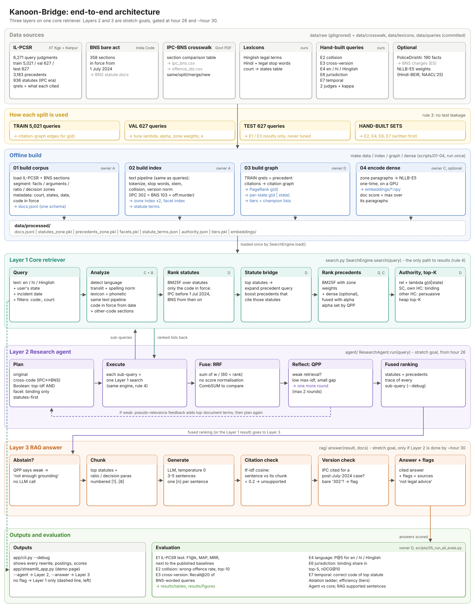

# Kanoon-Bridge

Legal search for Indian criminal law across the July 2024 IPC → BNS change.
One query — in BNS or IPC terms, in English, Hindi or Hinglish — finds the right statute
in both codes and the precedents that apply it, ranked by jurisdiction and date.

CSD358 (Information Retrieval) IR Hackathon · Track T6 (vertical search: law) with a T5 (Hinglish) layer.

> Not legal advice. This is a course research prototype.



Three layers on one core: **(1) core retriever** → **(2) research agent** → **(3) grounded answer**,
plus the **statutory drift layer** (`drift/`) that measures how far each provision moved from the IPC, CrPC and
Evidence Act to the BNS, BNSS and BSA.
See `ARCHITECTURE.md` and the pipeline figure in `docs/report/pipeline.png`.

## Quick start (from the zip)

```bash
cd kanoon-bridge
python -m venv .venv && source .venv/bin/activate      # Windows: .venv\Scripts\activate
pip install -e ".[dev]"
# IL-PCSR is not redistributed (CC-BY-NC-SA): copy your five parquet files in
mkdir -p data/raw/ilpcsr && cp /path/to/raw/ilpcsr/*.parquet data/raw/ilpcsr/
make build          # corpus + indexes + citation graph + LTR model, about 6 minutes
make web            # http://localhost:8000
make test           # 198 tests
```

The BNS sections (`data/raw/bns-study-platform`) and the government crosswalk PDF are
included. `make eval` re-runs every experiment (about an hour on 2 CPU cores); the results of
our run are already in `results/tables/` and `results/figures/`.

## New: statutory drift — change-aware retrieval (course project)

v1 treats every IPC section and its BNS successor as *the same offence*. That is true for IPC 302 → BNS 103.
It is not true for IPC 124A (sedition) → BNS 152, a different offence with a new mental state and a
higher punishment. The drift layer measures the change from the bare-act texts:

- clause-level retention and novelty, with cross-references renumbered;
- punishment structure;
- mental-state words and thresholds.

It turns these into a class and a **carry-over score** for old-code precedent. The search engine
down-weights precedents whose law changed, and explains why. Answers are checked for stale law.
A new **What changed** page shows every section side by side.

It covers all three codes replaced on 1 July 2024: IPC → BNS, CrPC → BNSS and Evidence Act → BSA.
For example, BNSS 187 is flagged as changed from CrPC 167, because the 15 days of police custody
may now be taken "in parts, at any time during the initial forty days or sixty days".
The old and procedure codes are read from India Code's current consolidated text
([kanoonhq/open-laws](https://github.com/kanoonhq/open-laws), CC0).

```bash
make drift                                   # build data/crosswalk/drift_*.csv (committed; needs make fetch to rebuild)
make drift-eval                              # E11-E12 against two independent gold sources
python app/cli.py "" --drift ipc:124a        # what changed for one section (no index needed)
python app/cli.py "" --drift "CrPC 438"      # also CrPC / BNSS / Evidence Act / BSA sections
make web                                     # then open /changes.html (works even before the indexes are built)
```

| E11a, test half (BNS sections) | F1 "changed" vs S1 | vs S2 |
| --- | --- | --- |
| v1 crosswalk relation | 0.21 | 0.32 |
| Edit similarity (tuned on dev) | 0.62 | 0.68 |
| Drift rules (hand-set) | 0.85 | 0.76 |
| Drift vector + logistic regression | **0.89** (κ 0.85) | **0.81** (κ 0.73) |

- The two gold sources agree with each other at κ = 0.75.
- Repeal detection: AUC 0.96; F1 0.54 vs 0.38 for v1.
- Punishment parsing agrees with the source's own summaries on 95–100% of fields.
- **CrPC → BNSS and Evidence Act → BSA:** plain edit similarity detects changes as well as or
  better than the drift rules (0.78 vs 0.75; 0.53 vs 0.40), a negative result outside penal
  law. The drift layer still supplies the per-pair carry-over and the explanations.
- Switching from the MIT copies to India Code's text lifted the penal rules from 0.68 to 0.85 F1.

Full write-up, ablations, negative results and limitations: **[docs/PROJECT.md](docs/PROJECT.md)**.

## New: verified research agent and computed answers (agent v2, RAG v2)

The agent now routes each question (pasted judgment / section lookup / fact question), picks the
code family from what it retrieved, verifies its top statutes (family, code in force, heading,
no definition sections) and writes a research memo with issue coverage. The answer layer
computes the punishment from the statute text, checks every sentence against its source
(numbers, sections, code in force, negation, verbatim quotes) and repairs or removes what fails,
listing each correction. Runs without IL-PCSR and without an API key:

```bash
make open           # all six codes from India Code + the BNS; eCourts judgments once fetched (scripts/11)
make layers-eval    # E14-E16
```

| | v1 | v2 |
| --- | --- | --- |
| E14 right punishment, 273 BNS questions | 0.05 | **0.86** |
| E15 injected wrong term of years caught | 0.23 | **0.89** |
| E15 false alarms on clean answers | 0.80 | **0.01** |
| E16 right section of the right code @1, CrPC/BNSS questions (E9) | 0.75 | **0.82** |

E15 injects the error types the verifier was built for (an upper bound), and E7/E9/E14 use
heading-style questions. Details, ablations and caveats: [docs/PROJECT.md §6](docs/PROJECT.md).

## New: results on the full corpus, real questions and the research extensions

```bash
make build && make ilpcsr-layers                 # E17-E18 on IL-PCSR (parallel recipe in scripts/18)
python scripts/00_fetch_data.py --only bail      # IndianBailJudgments-1200 (CC-BY-4.0)
python scripts/21_eval_extensions.py all         # E19 facts -> sections, ToC variant, E22 KV reuse
python scripts/11_hc_judgments.py fetch --years 2024 2025 && python scripts/11_hc_judgments.py ingest
python scripts/21_eval_extensions.py e10 --tag hc   # after make data index graph
python scripts/20_build_treatment.py --eval      # E21 overruled precedents
python scripts/19_eval_misgrounding.py --generator local   # E20, with an LLM server on your GPU
python scripts/22_annotation_kit.py make         # sheets for a law student (annotation/)
```

| Result | Number |
| --- | --- |
| E9 procedure questions, MAP: core → agent v2 (IL-PCSR, Holm p 0.04) | 0.859 → **0.903** |
| E4 Hindi / Hinglish needs, MAP: core → agent v2 (Holm p 0.04) | 0.461 → **0.536** |
| E19 written facts of 995 bail orders → charged sections, MAP: core → agent v2 | 0.047 → **0.100** |
| E18 right punishment on IL-PCSR: RAG v1 → RAG v2 | 0.06 → **0.86** |
| E10 IPC-numbered questions → BNS-era High Court judgments, MAP: BM25 → core | 0.004 → **0.151** |
| High Court criminal judgments citing the BNS, 2025 (eCourts, 1,701 judgments) | only 10–29% a month |
| E21 judgments flagged overruled (all five correct on our check) | 5 |
| E22 prompt tokens that repeat across 2,082 legal RAG questions | 63% |
| STAIR-style ToC navigation (no training) | no gain: a negative result |

Not yet measured: LLM misgrounding (E20 needs a GPU or an API key), and human labels (the
annotation kit is ready). Details and caveats: [docs/PROJECT.md §7](docs/PROJECT.md).

## Results (IL-PCSR test split and our test sets)

| Set | Metric | BM25 baseline | Kanoon-Bridge |
| --- | --- | --- | --- |
| E1 precedents (627 judgments) | MAP / F1@k / MRR | 0.220 / 0.151 / 0.316 | **0.414 / 0.308 / 0.560** |
| E1 statutes | MAP / F1@k / MRR | 0.149 / 0.118 / 0.281 | **0.220 / 0.189 / 0.449** |
| E1q typed-question proxies (40 words) | MAP | 0.051 | 0.059 (0.076 with the short-query LTR) |

**Against IL-PCSR's own strongest lexical baseline** (BM25 over word 3-grams, run by us; the paper's
published test numbers in brackets, [Paul et al. 2025](https://arxiv.org/abs/2511.00268) Table 3):

| Set | Metric | IL-PCSR BM25 3-gram: ours [paper] | Kanoon-Bridge | Paired test |
| --- | --- | --- | --- | --- |
| E1 precedents | MAP / F1@k / MRR | 0.409 / 0.306 / 0.548 [0.434 / 0.322 / 0.575] | 0.414 / 0.308 / 0.559 | +0.005 MAP, n.s. (p = 0.34) |
| E1 statutes | MAP / F1@k / MRR | 0.185 / 0.170 / 0.384 [0.194 / 0.178 / 0.417] | 0.220 / 0.189 / 0.449 | +0.035 MAP, significant |
| E1q typed proxies | MAP | 0.046 | 0.059 | +0.013 MAP, significant |

So on pasted judgments our gain over unigram BM25 is the trigram channel, which is IL-PCSR's idea.
The paper's trained models (Para-GNN + BM25: 0.502 / 0.521 MAP; GPT-4.1 re-ranking: 0.544 / 0.611)
stay ahead of us on E1.

| Set | Metric | BM25 baseline | Kanoon-Bridge |
| --- | --- | --- | --- |
| E3 asked in BNS numbers | MAP | 0.006 | **0.655** |
| E8 asked in BNSS / BSA numbers | MAP | 0.005 | **0.654** |
| E9 CrPC vs BNSS, IEA vs BSA by date | MAP | 0.630 | **0.859** |
| E4 English / Hindi / Hinglish (50 needs) | MAP | 0.395 | **0.461** |
| E6 jurisdiction | nDCG@10 | 0.366 | **0.657** |
| E7 right code at rank 1 | accuracy | 0.475 | **0.955** |
| E2 colliding numbers | wrong-offence hits in top 10 | 7.5% | **0%** |

All differences except E2's MAP and E1q are significant (paired randomization test, Holm-corrected).
Second judge (blind AI sub-agents, declared): Cohen's κ = 0.54 on E4 and −0.16 on E6
(`results/tables/agreement.csv`; see the report for why E6's citation-based gold disagrees).
The dense channel and the post-2024 High Court judgments are run on a Colab T4 with
`notebooks/colab_gpu_run.ipynb`.
Full tables (with the 3-gram baseline as system `ilpcsr_bm25_3gram`): `results/tables/main_results.csv`, `significance.csv`, `ablation_e1_ilpcsr.csv`.
Report and video script: `docs/report/`.

---

## Status

| Component | Owner | Status |
| --- | --- | --- |
| Shared schema, config, storage, text pipeline, search entry point | all | working |
| Data fetch, IL-PCSR loader, BNS loader, segmentation, metadata (courts, states, dates) | Gaurav | **working** |
| Crosswalk (496 IPC-BNS pairs), version normalisation, collision resolver | Gaurav | **working** |
| tf-idf, BM25F, statute bridge, citation graph, PageRank authority, QPP, tiers | Gaurav | **working** |
| Legal tokeniser (section tokens) | Sharanya | working |
| Positional / zone / facet indexes, Boolean + phrase + proximity query parser and evaluation | Sharanya | **working** |
| Transliteration, Hinglish normalisation, ~165-row legal lexicon, phonetic matching, Hindi stemming, dense channel | Kashvi | **working** (dense needs `make dense` on a GPU) |
| Research agent, layer 2: rule planner (cross-code, Boolean, facet, statutes), RRF/CombSUM, QPP reflection + PRF, optional LLM planner | Shaurya | **working** |
| Evaluation: test sets E1-E7, ablation ladder, language ablation, efficiency, plots | Gaurav | **working** |
| Agent vs core and RAG evaluation | Gaurav | **working** |
| RAG answer, layer 3: abstain, chunks, Claude/extractive generation, citation + version checks | Gaurav | **working** |
| Web app (app/web_server.py + app/web/): bridge search, advocate answers, history, step-by-step "how this was found" | Gaurav | **working** |
| Statutory drift (drift/) for IPC→BNS, CrPC→BNSS and Evidence Act→BSA: drift vector, classes, carry-over, transfer in ranking, answer checks, "What changed" page, E11-E13 | Gaurav | **working** (E13 needs the IL-PCSR indexes) |
| Tolerant retrieval: spelling correction + did-you-mean, wildcards; snippets, highlighting, "why this result"; similar cases; relevance feedback; learning to rank; near-duplicate collapse; typo experiment | Gaurav | **working** |

Every feature, the paper or textbook section it builds on, and what is new: **[docs/RESEARCH.md](docs/RESEARCH.md)**.

Update this table as components land. Stubs raise `NotImplementedError` with a TODO saying what to build.

---

> **Step-by-step guide to download every dataset and run everything (including the PDF
> cross-check and the RAG layer): [SETUP_AND_RUN.md](SETUP_AND_RUN.md).**

## Setup

```bash
git clone <repo-url> kanoon-bridge
cd kanoon-bridge
python -m venv .venv && source .venv/bin/activate     # Windows: .venv\Scripts\activate
pip install -e ".[dev]"            # core + pytest
pip install -e ".[dense]"          # optional: sentence-transformers for the dense channel
pip install -e ".[app]"            # optional: streamlit demo
make test                          # should pass on a fresh clone
```

Python 3.10+.

## Data

For easy access go to: https://drive.google.com/drive/folders/1fIHr80Uz0QNTrk9BDXvpmFvsHk8A8MLI?usp=sharing

Downloads go in `data/raw/` (gitignored). One command fetches both sources:

```bash
pip install -e ".[data]"
huggingface-cli login              # IL-PCSR is gated: accept its terms on the dataset page first
make fetch                         # = python scripts/00_fetch_data.py
make check                         # PASS/MISSING per item + TODOs left per owner
```

| Data | Source | Lands in |
| --- | --- | --- |
| IL-PCSR (IIT Kharagpur + IIT Kanpur), CC-BY-NC-SA 4.0 | https://huggingface.co/datasets/Exploration-Lab/IL-PCSR | `data/raw/ilpcsr/<config>/<split>.parquet` |
| BNS bare-act text (358 sections) + each section's IPC correspondence | https://github.com/PSKprem/bns-study-platform (`data/sections/*.json`) | `data/raw/bns-study-platform/` |
| IPC↔BNS crosswalk (derived) | generated by `make crosswalk` from the source above | `data/crosswalk/*.csv` (committed) |
| Government comparison table (optional cross-check) | https://www.keralaprisons.gov.in/userfiles/act-and-rules/comparison_summary_BNS_to_IPC.pdf | `data/raw/crosswalk/` |
| PoliceDrishti (gated, optional) | https://huggingface.co/datasets/happyman11/PoliceDristi | `data/raw/policedrishti/` |
| NLLB-E5 weights (optional) | https://github.com/ArkadeepAcharya/NLLB-E5 | downloaded by `scripts/04_encode_dense.py` |

From the bns-study-platform repository we use only the bare-act text (government material) and the
section-number correspondences; none of its commentary.

**No Hugging Face access yet?** `make sample` runs the whole offline build on a tiny synthetic
sample in IL-PCSR's exact schema (`tests/data/`, fictional cases — never report results on it).


No crawling. If any is added later: obey robots.txt, rate-limit, collect no personal data.

## How to run

```bash
make data      # scripts/01_build_corpus.py  → crosswalk CSVs + data/processed/docs.jsonl
make index     # scripts/02_build_index.py   → data/processed/index/
make graph     # scripts/03_build_graph.py   → citation graph + authority scores
make dense     # scripts/04_encode_dense.py  → paragraph embeddings (GPU recommended)
make ltr       # scripts/06_train_ltr.py     → learned re-ranker (trained on val)
make eval      # scripts/05_run_all_evals.py → results/tables, results/figures
make web       # the web app: http://localhost:8000 (search on the bridge, advocate answers, history, how-it-was-found)
make app       # older Streamlit demo
python app/cli.py "mere bhai ko chaku maara" --state delhi --date 2025-03-01 --debug
python app/cli.py "..." --agent --debug    # layer 2: several sub-queries, fused (trace shows each one)
python app/cli.py "..." --answer           # layer 3: cited answer with checks (Claude if a key is in .env)
make compare   # crosswalk vs the government PDF (download it by hand first)
make eval-quick / make eval-sample / make plots
```

## Repo layout

`ARCHITECTURE.md` explains the design end to end (data usage, worked example, evaluation, gates).
`PROJECT_STRUCTURE.md` lists every file: owner, status, purpose, and the functions it must contain.

## Team rules

1. Everything passes `schema.py` objects (`Document`, `Query`, `ScoredDoc`).
2. Documents and queries go through the same `text/` pipeline.
3. No test leakage: graph building and tuning use train/val only.
4. The app and the evaluator both call `kanoon_bridge.search.search()`.
5. Log AI use in `docs/ai_use.md` as you go.

## Credits

IL-PCSR (Paul et al., 2025), BNS bare-act text and IPC correspondences via the bns-study-platform project (PSKprem), Hindi-BEIR / NLLB-E5 (Acharya et al., NAACL 2025), CaseLink (Tang et al., SIGIR 2024),
QPP for agentic RAG (Tian et al., IR-RAG@SIGIR 2025), PoliceDrishti dataset. Spatio-temporal facets inspired by
the work of Dr. Sonia Khetarpaul (SNU).
